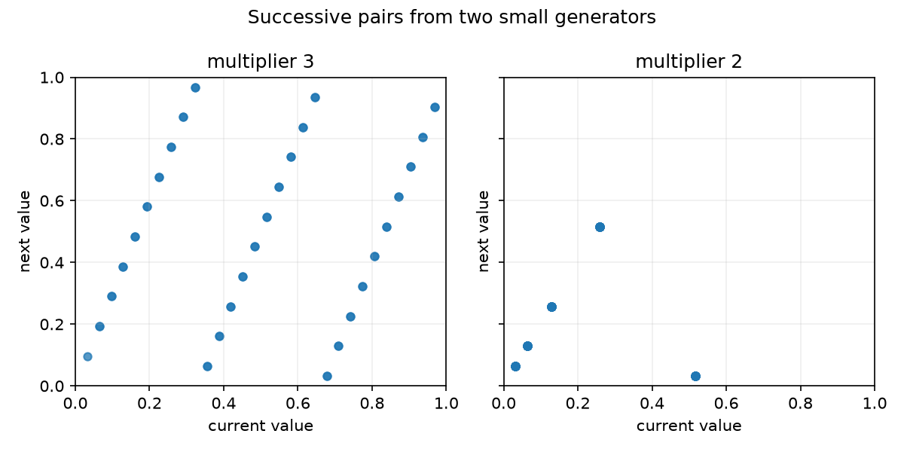

# A tiny congruential generator

This is a small version of the multiplicative congruential method from the
random-number-generation lecture. Starting from a seed, it repeatedly uses

```text
x[n] = multiplier * x[n-1] mod modulus
```

and divides the states by the modulus to get values between zero and one.

I kept the modulus at `31` so the complete cycle is easy to inspect. With
seed `1`, multiplier `3` has period `30`, while multiplier `2` only has period
`5`. The script plots successive pairs for both choices, which makes the
short repeating pattern fairly obvious.

This is only an educational generator. For an actual simulation I would use
a tested generator from NumPy or Python instead.

From the main folder:

```bash
python3 -m monte_carlo.congruential_generator.generator
python3 -m unittest monte_carlo.congruential_generator.test_generator
```


